# Image Generation — 30 картинок в 4K

30 процедурно сгенерированных изображений **3840×2160** на темы космоса, природы, техники и математики.
Каждая картинка полностью нарисована кодом на Python (NumPy + OpenCV): без нейросетей, без фотографий и сторонних текстур.
Скрипты в папке [`src/`](src) пересоздают всю галерею один в один.

Нажми на превью, чтобы открыть оригинал в 4K.

| | | |
|---|---|---|
| <a href="images/01-nebula.jpg">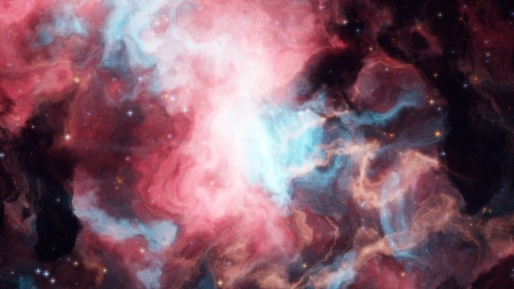</a> | <a href="images/02-spiral-galaxy.jpg">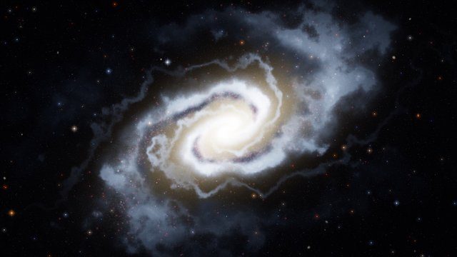</a> | <a href="images/03-ringed-giant.jpg">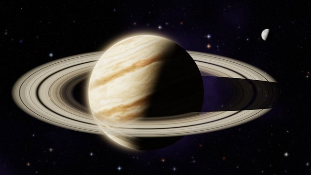</a> |
| **1. Эмиссионная туманность** | **2. Спиральная галактика** | **3. Окольцованный гигант** |
| <a href="images/04-black-hole.jpg">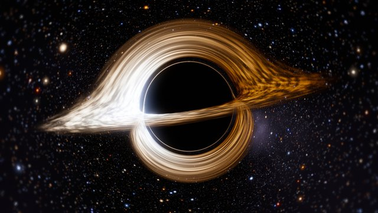</a> | <a href="images/05-milky-way-lake.jpg">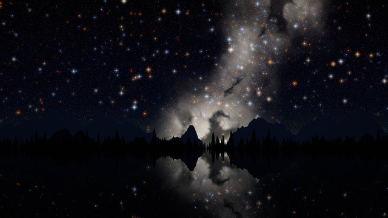</a> | <a href="images/06-alien-world.jpg">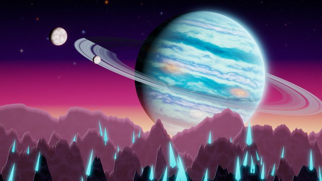</a> |
| **4. Чёрная дыра** | **5. Млечный Путь над озером** | **6. Чужой мир** |
| <a href="images/07-solar-eclipse.jpg">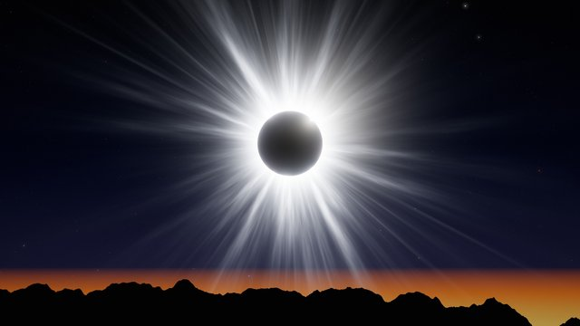</a> | <a href="images/08-aurora.jpg">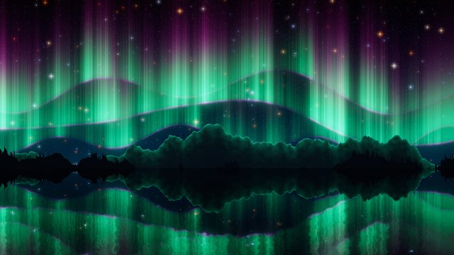</a> | <a href="images/09-misty-mountains.jpg">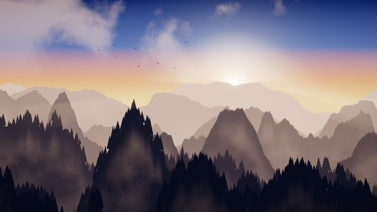</a> |
| **7. Полное солнечное затмение** | **8. Северное сияние** | **9. Горы в тумане** |
| <a href="images/10-ocean-sunset.jpg">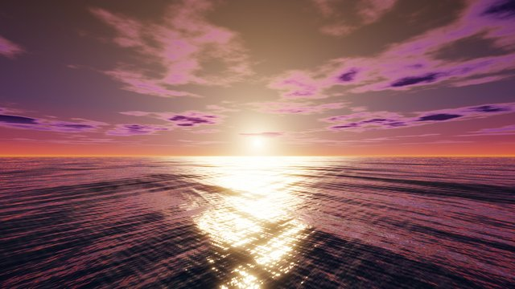</a> | <a href="images/11-forest-light.jpg">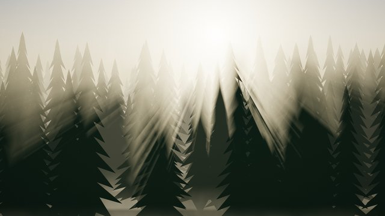</a> | <a href="images/12-aerial-terrain.jpg">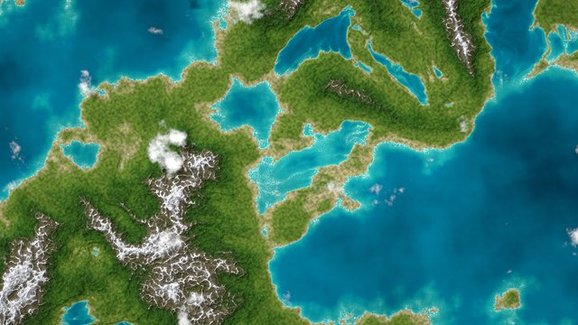</a> |
| **10. Закат над океаном** | **11. Лучи в хвойном лесу** | **12. Остров со спутника** |
| <a href="images/13-underwater.jpg">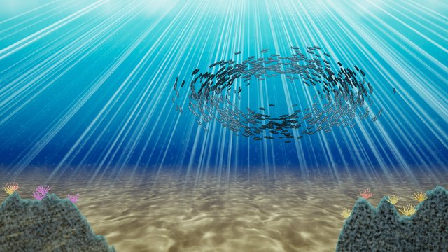</a> | <a href="images/14-desert-dunes.jpg">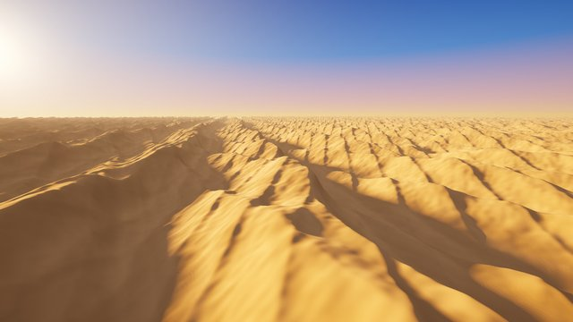</a> | <a href="images/15-lightning-storm.jpg">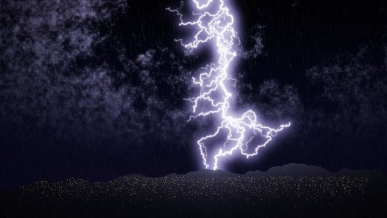</a> |
| **13. Под водой** | **14. Песчаные дюны** | **15. Гроза** |
| <a href="images/16-sakura-tree.jpg">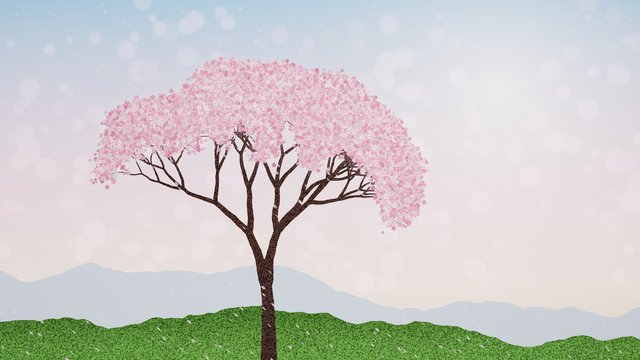</a> | <a href="images/17-snowflake.jpg"></a> | <a href="images/18-cyberpunk-city.jpg">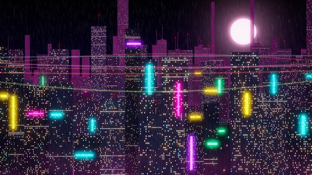</a> |
| **16. Цветущая сакура** | **17. Снежинка** | **18. Киберпанк-город** |
| <a href="images/19-circuit-board.jpg">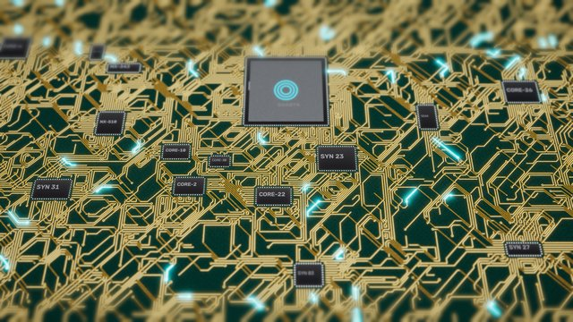</a> | <a href="images/20-synthwave.jpg">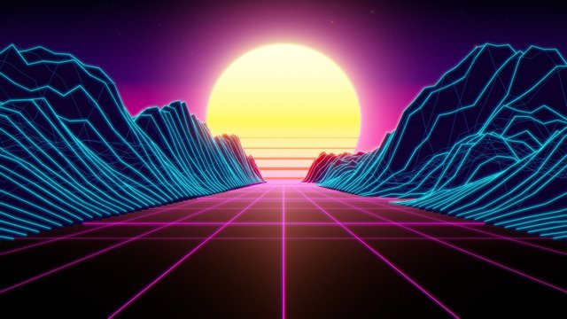</a> | <a href="images/21-chrome-spheres.jpg">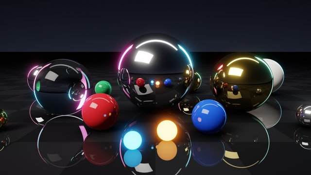</a> |
| **19. Печатная плата** | **20. Synthwave** | **21. Хромированные сферы** |
| <a href="images/22-neural-network.jpg">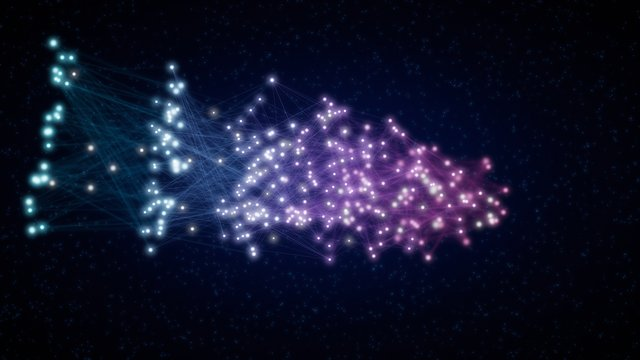</a> | <a href="images/23-clifford-attractor.jpg">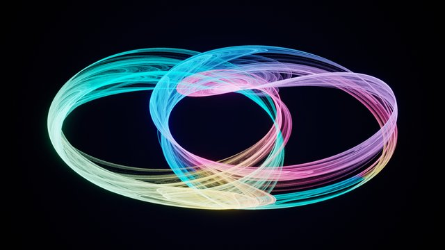</a> | <a href="images/24-light-painting.jpg">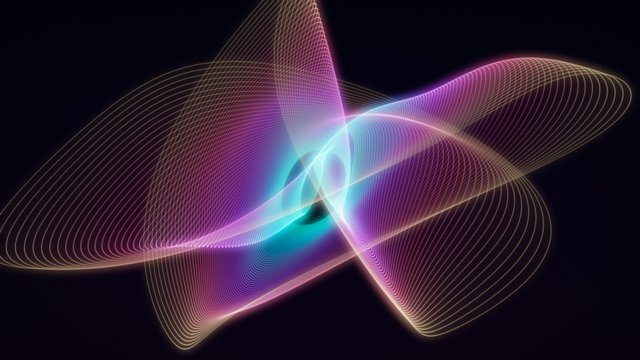</a> |
| **22. Нейросеть в 3D** | **23. Аттрактор Клиффорда** | **24. Гармонограф** |
| <a href="images/25-mandelbrot.jpg">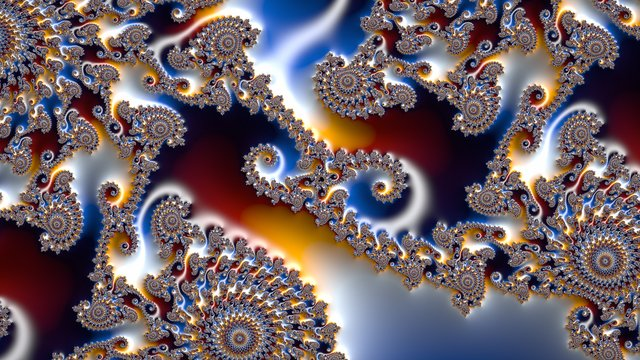</a> | <a href="images/26-julia-set.jpg">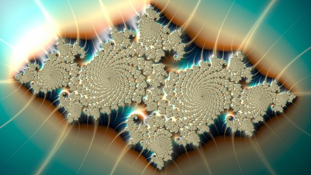</a> | <a href="images/27-reaction-diffusion.jpg">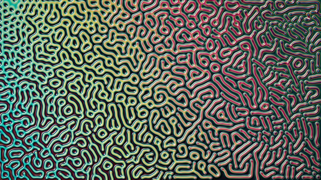</a> |
| **25. Множество Мандельброта** | **26. Множество Жюлиа** | **27. Реакция-диффузия** |
| <a href="images/28-gold-marble.jpg">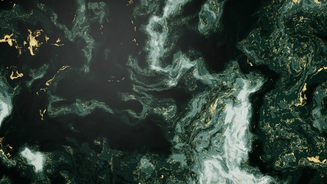</a> | <a href="images/29-geode.jpg">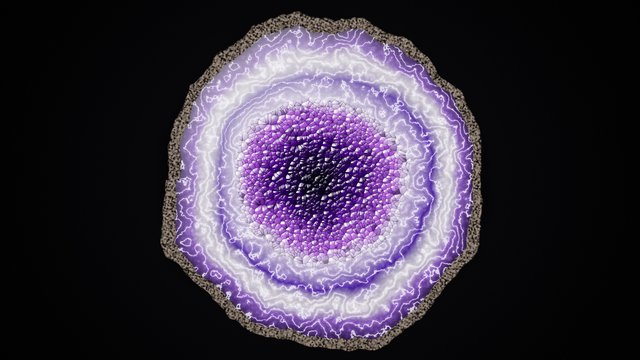</a> | <a href="images/30-hyperspace.jpg">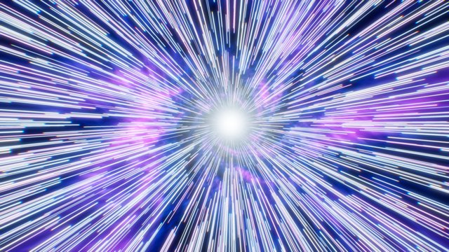</a> |
| **28. Мрамор с золотом** | **29. Аметистовая жеода** | **30. Прыжок в гиперпространство** |

## Что где

| # | Картинка | Тема | Техника |
|---|---|---|---|
| 1 | [Эмиссионная туманность](images/01-nebula.jpg) | Космос | многоуровневый domain-warping шум, H-alpha/OIII каналы, пылевые прожилки, 60 000 звёзд |
| 2 | [Спиральная галактика](images/02-spiral-galaxy.jpg) | Космос | логарифмические рукава, пылевые полосы, 2.5 млн отдельных звёзд, области HII |
| 3 | [Окольцованный гигант](images/03-ringed-giant.jpg) | Космос | газовый гигант с полосами и штормами, кольца с щелями, тень планеты на кольцах и колец на планете |
| 4 | [Чёрная дыра](images/04-black-hole.jpg) | Космос | настоящая трассировка геодезических Шварцшильда, линзирование диска и звёзд, доплеровское усиление |
| 5 | [Млечный Путь над озером](images/05-milky-way-lake.jpg) | Космос | галактическая полоса с пылью, 160 000 звёзд, хвойный лес, отражение в воде |
| 6 | [Чужой мир](images/06-alien-world.jpg) | Космос | планета с кольцами восходит над горами со светящимися кристаллами, две луны |
| 7 | [Полное солнечное затмение](images/07-solar-eclipse.jpg) | Космос | стримеры короны, протуберанцы, кольцевой закат на горизонте |
| 8 | [Северное сияние](images/08-aurora.jpg) | Природа | лучистые занавесы сияния, заснеженные горы, отражение в озере |
| 9 | [Горы в тумане](images/09-misty-mountains.jpg) | Природа | 8 планов хребтов, туман в долинах, хвойные леса, солнечные лучи |
| 10 | [Закат над океаном](images/10-ocean-sunset.jpg) | Природа | 56 волн со спектральной фильтрацией, отражения по Френелю, солнечная дорожка, перспективные облака |
| 11 | [Лучи в хвойном лесу](images/11-forest-light.jpg) | Природа | 8 планов елей, объёмные солнечные лучи, пылинки в свете |
| 12 | [Остров со спутника](images/12-aerial-terrain.jpg) | Природа | фрактальный рельеф, отмывка, снег, растительность, отмели, облака с тенями |
| 13 | [Под водой](images/13-underwater.jpg) | Природа | каустики на дне, лучи света, стая из 900 рыб, кораллы, окно Снеллиуса |
| 14 | [Песчаные дюны](images/14-desert-dunes.jpg) | Природа | ray marching карты высот, мягкие тени от солнца, рябь от ветра, воздушная перспектива |
| 15 | [Гроза](images/15-lightning-storm.jpg) | Природа | фрактальная молния с ветвями, подсвеченные облака, дождь, огни города |
| 16 | [Цветущая сакура](images/16-sakura-tree.jpg) | Природа | рекурсивное дерево, тысячи пятилепестковых цветков, летящие лепестки |
| 17 | [Снежинка](images/17-snowflake.jpg) | Природа | рост кристалла по модели Рейтера на гексагональной сетке, ледяное освещение |
| 18 | [Киберпанк-город](images/18-cyberpunk-city.jpg) | Техника | 6 планов небоскрёбов, окна, неоновые вывески, туман, дождь, трассы |
| 19 | [Печатная плата](images/19-circuit-board.jpg) | Техника | трассировка дорожек, микросхемы, переходные отверстия, импульсы данных, tilt-shift |
| 20 | [Synthwave](images/20-synthwave.jpg) | Техника | полосатое солнце, неоновая сетка, каркасные горы, хроматическая аберрация |
| 21 | [Хромированные сферы](images/21-chrome-spheres.jpg) | Техника | векторный трассировщик лучей: хром, золото, стекло с преломлением, софтбоксы, 4 сэмпла/пиксель |
| 22 | [Нейросеть в 3D](images/22-neural-network.jpg) | Техника | 7 слоёв, тысячи связей, глубина резкости, импульсы сигнала |
| 23 | [Аттрактор Клиффорда](images/23-clifford-attractor.jpg) | Математика | 200 млн итераций странного аттрактора, цвет по направлению движения |
| 24 | [Гармонограф](images/24-light-painting.jpg) | Математика | 36 млн точек затухающих маятников, световая живопись |
| 25 | [Множество Мандельброта](images/25-mandelbrot.jpg) | Математика | «Долина морских коньков», 2400 итераций, сглаженная раскраска, рельефное освещение |
| 26 | [Множество Жюлиа](images/26-julia-set.jpg) | Математика | c = −0.7269 + 0.1889i, ловушки орбит, рельеф |
| 27 | [Реакция-диффузия](images/27-reaction-diffusion.jpg) | Математика | модель Грея–Скотта, 6000 шагов, глянцевый рельеф |
| 28 | [Мрамор с золотом](images/28-gold-marble.jpg) | Абстракция | трёхуровневое искажение пространства, золотые прожилки с блёстками |
| 29 | [Аметистовая жеода](images/29-geode.jpg) | Абстракция | агатовые полосы, кристаллы Вороного с гранями и бликами |
| 30 | [Прыжок в гиперпространство](images/30-hyperspace.jpg) | Абстракция | звёздные полосы, туннель туманности, радиальная хроматическая аберрация |

## Как пересоздать

```bash
pip install numpy opencv-python pillow scipy
cd src
python render.py                 # все 30 картинок в 4K → ../images
python render.py --only 4,21     # только выбранные
python render.py --scale 0.25    # быстрые превью 960×540
```

Вся галерея рендерится примерно за 15 минут на двух ядрах CPU. Дольше всего считаются дюны (ray marching), трассировщик лучей и аттрактор.

## Устройство

- `src/common.py`: фрактальный шум (fBm, ridged, тайловый), звёздные поля с PSF и дифракционными лучами, тонмаппинг ACES, bloom, виньетка, плёночное зерно.
- `src/landscape.py`: профили хребтов, силуэты, отражения в воде.
- `src/space.py`, `src/blackhole.py`: космос.
- `src/nature.py`, `src/ocean.py`, `src/dunes.py`: природа.
- `src/tech.py`, `src/raytrace.py`: техника.
- `src/abstract.py`: фракталы, аттракторы, реакция-диффузия, мрамор, жеода, гиперпространство.
